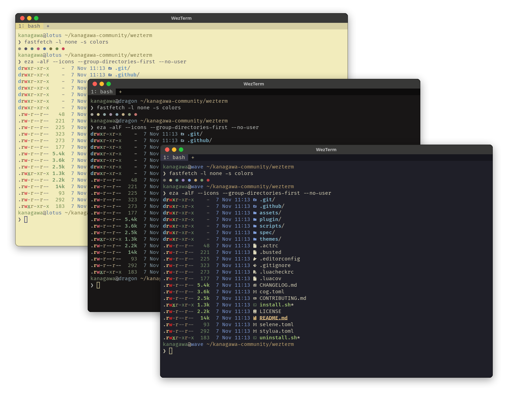
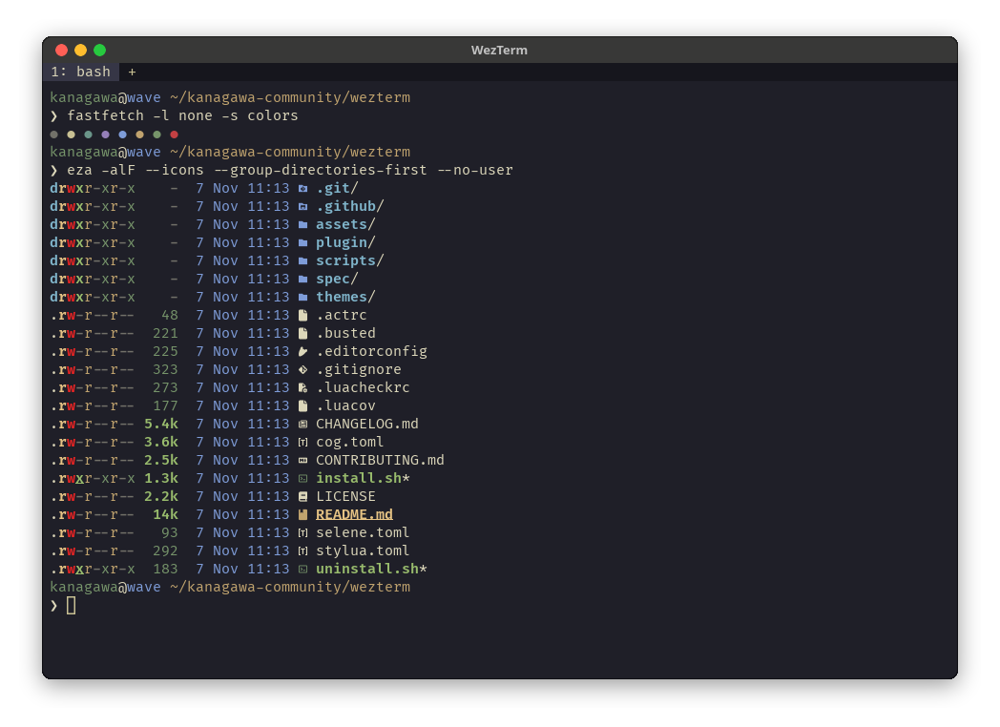
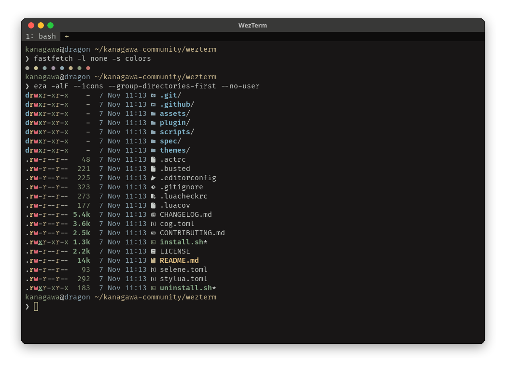
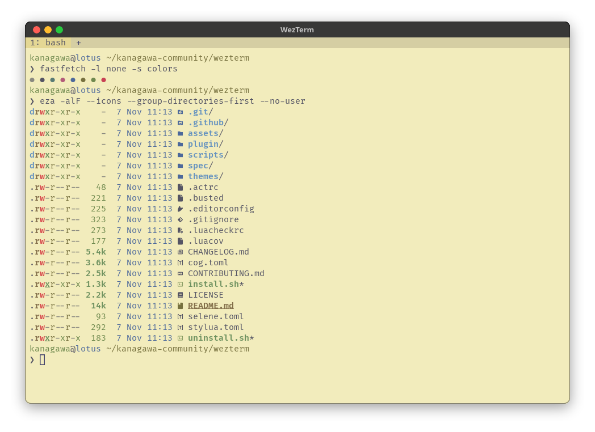

<h3>Kanagawa for <a href="https://wezterm.org/">WezTerm</a></h3>
<p>A community-maintained theme inspired by Hokusai's <em>The Great Wave off Kanagawa</em>.</p>
<p>Using the <a href="https://github.com/rebelot/kanagawa.nvim">Kanagawa palette</a> by <a href="https://github.com/rebelot">Tommaso Laurenzi (rebelot)</a>.</p>

<!-- Wave accents: carpYellow, crystalBlue, autumnRed. Lotus accents: lotusYellow, lotusBlue4, lotusRed. -->
<p>
  <a href="https://github.com/kanagawa-community/wezterm/stargazers">
    <picture>
      <source media="(prefers-color-scheme: dark)" srcset="https://img.shields.io/github/stars/kanagawa-community/wezterm?style=for-the-badge&amp;labelColor=1F1F28&amp;color=E6C384">
      <source media="(prefers-color-scheme: light)" srcset="https://img.shields.io/github/stars/kanagawa-community/wezterm?style=for-the-badge&amp;labelColor=F2ECBC&amp;color=77713F">
      
    </picture>
  </a>
  <a href="https://github.com/kanagawa-community/wezterm/releases/latest">
    <picture>
      <source media="(prefers-color-scheme: dark)" srcset="https://img.shields.io/github/v/release/kanagawa-community/wezterm?style=for-the-badge&amp;label=release&amp;labelColor=1F1F28&amp;color=7E9CD8">
      <source media="(prefers-color-scheme: light)" srcset="https://img.shields.io/github/v/release/kanagawa-community/wezterm?style=for-the-badge&amp;label=release&amp;labelColor=F2ECBC&amp;color=4D699B">
      
    </picture>
  </a>
  <a href="https://github.com/kanagawa-community/wezterm/issues">
    <picture>
      <source media="(prefers-color-scheme: dark)" srcset="https://img.shields.io/github/issues/kanagawa-community/wezterm?style=for-the-badge&amp;labelColor=1F1F28&amp;color=C34043">
      <source media="(prefers-color-scheme: light)" srcset="https://img.shields.io/github/issues/kanagawa-community/wezterm?style=for-the-badge&amp;labelColor=F2ECBC&amp;color=C84053">
      
    </picture>
  </a>
</p>

<br clear="both">
<br>

## Previews



<details>
<summary>🌊 Wave</summary>

</details>

<details>
<summary>🐉 Dragon</summary>

</details>

<details>
<summary>🪷 Lotus</summary>

</details>

## Requirements

- WezTerm 20230712 or later, for plugins. The TOML schemes need WezTerm 20220807 or later.

## Installation

### Plugin

Load the plugin in `~/.config/wezterm/wezterm.lua`:

```lua
local wezterm = require "wezterm"

-- from git
local kanagawa = wezterm.plugin.require "https://github.com/kanagawa-community/wezterm"

-- from a local checkout
local kanagawa = wezterm.plugin.require(
  "file:///" .. wezterm.config_dir .. "/plugins/wezterm"
)
```

The old URL, `https://github.com/sravioli/kanagawa.wz`, redirects here and
keeps working.

#### Type annotations

Kanagawa ships LuaCATS annotations. After installing
[wezterm-types](https://github.com/DrKJeff16/wezterm-types), annotate the import
to get completion and type checking:

```lua
---@type Kanagawa
local kanagawa = wezterm.plugin.require("https://github.com/kanagawa-community/wezterm")
```

### Color scheme files

If you do not want a plugin, use the TOML schemes in [`themes/`](themes/).
Download them into ~/.config/wezterm/colors:

```sh
mkdir -p ~/.config/wezterm/colors
for variant in wave dragon lotus; do
  curl -fsSL -o ~/.config/wezterm/colors/kanagawa-$variant.toml https://raw.githubusercontent.com/kanagawa-community/wezterm/main/themes/kanagawa-$variant.toml
done
```

Or clone the repository and run `./install.sh`. It installs all three variants,
or only the ones you name, for example `./install.sh dragon lotus`. `./uninstall.sh`
takes the same names and removes them.

Then select one in `wezterm.lua`:

```lua
config.color_scheme = "Kanagawa Wave"
```

## Usage

With the plugin:

### apply_to_config

This is the usual entry point. It resolves a scheme (default: `"wave"`), applies
any overrides, registers the result in `config.color_schemes`, and sets
`config.color_scheme` to the matching display name.

WezTerm applies `config.colors` after `color_scheme`. Thus you can use
`config.colors` to change some keys of the scheme.

```lua
-- use the default wave scheme
kanagawa.apply_to_config(config)

-- pick a different scheme
kanagawa.apply_to_config(config, { scheme = "dragon" })

-- pick a scheme and override some colors
kanagawa.apply_to_config(config, {
  scheme = "lotus",
  overrides = {
    background = "#ffffff",
    tab_bar = { background = "#e0e0e0" },
  },
})

-- further per-key tweaks via config.colors still work
config.colors = {
  cursor_bg = "#ff0000",
}
```

| Option      | Type    | Default  | Description                                   |
| ----------- | ------- | -------- | --------------------------------------------- |
| `scheme`    | string? | `"wave"` | Scheme name: `"wave"`, `"lotus"`, `"dragon"`. |
| `overrides` | table?  | `nil`    | Keys to change. They merge into the scheme.   |

Display names registered in `config.color_schemes`:

| Scheme   | Display name      |
| -------- | ----------------- |
| `wave`   | `Kanagawa Wave`   |
| `lotus`  | `Kanagawa Lotus`  |
| `dragon` | `Kanagawa Dragon` |

### register

`register()` adds all three variants to `config.color_schemes`, but it does not
select one. Select the scheme with `config.color_scheme`.

```lua
kanagawa.register(config)

config.color_scheme = "Kanagawa Dragon"
```

`overrides` changes keys in each scheme. `scheme_overrides` changes keys in one
scheme. When both change the same key, `scheme_overrides` is used.

```lua
kanagawa.register(config, {
  overrides = {
    tab_bar = { background = "#000000" },
  },
  scheme_overrides = {
    lotus = { background = "#ffffff" },
  },
})
```

| Option             | Type   | Default | Description                                |
| ------------------ | ------ | ------- | ------------------------------------------ |
| `overrides`        | table? | `nil`   | Keys to change in each scheme.             |
| `scheme_overrides` | table? | `nil`   | Per-scheme overrides keyed by scheme name. |

### apply_by_appearance

`apply_by_appearance()` selects the variant from the light or dark appearance
of WezTerm. By default, a light appearance uses `lotus`, a dark appearance uses
`wave`, and an unknown appearance uses `wave`.

```lua
kanagawa.apply_by_appearance(config)
```

You can select other schemes, and change keys for each appearance:

```lua
kanagawa.apply_by_appearance(config, {
  dark = "dragon",
  light = "lotus",
  fallback = "wave",
  overrides = {
    dark = {
      tab_bar = { background = "#111111" },
    },
    light = {
      tab_bar = { background = "#f5f0d0" },
    },
    fallback = {
      tab_bar = { background = "#000000" },
    },
  },
})
```

To select the appearance yourself, for example in tests, give an `appearance`
string. A string that contains `"light"` selects `light`. A string that
contains `"dark"` selects `dark`. Other strings select `fallback`.

```lua
kanagawa.apply_by_appearance(config, {
  appearance = "Light",
})
```

| Option       | Type    | Default   | Description                                              |
| ------------ | ------- | --------- | -------------------------------------------------------- |
| `dark`       | string? | `"wave"`  | Scheme used for dark appearances.                        |
| `light`      | string? | `"lotus"` | Scheme used for light appearances.                       |
| `fallback`   | string? | `"wave"`  | Scheme used when appearance cannot be resolved.          |
| `overrides`  | table?  | `nil`     | Role-based overrides keyed by `dark`/`light`/`fallback`. |
| `appearance` | string? | `nil`     | The appearance to use, for example in tests.             |

### get

`get()` gives a new scheme table each time. You can change the result, and the
shared presets do not change. The overrides merge into that new table.

```lua
-- get a clean copy of the dragon scheme
local colors = kanagawa.get "dragon"

-- get wave with a single ANSI color replaced
local colors = kanagawa.get("wave", {
  ansi = { [1] = "#ff0000" },
})

-- override a nested tab_bar field
local colors = kanagawa.get("wave", {
  tab_bar = { active_tab = { bg_color = "#000000" } },
})

config.colors = colors
```

### Direct preset access

The plugin also exports the base preset tables, so you can read them. All users
of the plugin share these tables, so do not change them. To get a copy, use
`get()`.

```lua
config.colors = kanagawa.wave
config.colors = kanagawa.lotus
config.colors = kanagawa.dragon
```

## Override semantics

Overrides merge into the scheme as follows:

- Nested tables, such as `tab_bar` and `active_tab`, merge at each level.
  Give only the keys that you change.
- In the list tables `ansi` and `brights`, you can change one index. For
  example, `{ ansi = { [3] = "#00ff00" } }` replaces only the third ANSI
  color. The other seven colors do not change.
- The plugin gives unknown keys to WezTerm and does not check them.

`get()`, `register()`, `apply_to_config()`, and `apply_by_appearance()` do not
change the base preset tables.

`apply_to_config()` adds the scheme to `config.color_schemes` and sets
`config.color_scheme`. WezTerm applies `color_scheme` first and `colors` after
it. Thus a key in `config.colors` replaces the same key of the scheme.

## API

| Export                                     | Description                                             |
| ------------------------------------------ | ------------------------------------------------------- |
| `kanagawa.wave`                            | Base Wave preset (shared reference).                    |
| `kanagawa.lotus`                           | Base Lotus preset (shared reference).                   |
| `kanagawa.dragon`                          | Base Dragon preset (shared reference).                  |
| `kanagawa.get(name, overrides?)`           | Return a fresh scheme table with optional overrides.    |
| `kanagawa.register(cfg, opts?)`            | Register all schemes without activating one.            |
| `kanagawa.apply_to_config(cfg, opts?)`     | Register scheme in `cfg.color_schemes` and activate it. |
| `kanagawa.apply_by_appearance(cfg, opts?)` | Activate a light/dark scheme based on appearance.       |

## Palette

Every color comes from the shared
[palette](https://github.com/kanagawa-community/.github/blob/main/docs/PALETTE.md),
picked by role, so each variant uses its own value for the same role.

| WezTerm color                                             | Palette role                         |
| --------------------------------------------------------- | ------------------------------------ |
| `background`, `cursor_fg`                                 | `ui.bg`                              |
| `foreground`, `selection_fg`, active tab text             | `ui.fg`                              |
| `cursor_bg`, `cursor_border`, inactive tab text           | `ui.fg_dim`                          |
| `selection_bg`, copy mode active highlight                | `ui.bg_visual`                       |
| `ansi`, `brights`                                         | `term.*`                             |
| `indexed` 16, 17                                          | `term.extended_1`, `term.extended_2` |
| `tab_bar.background`, inactive tab background             | `ui.bg_m3`                           |
| active tab background, `scrollbar_thumb`, launcher labels | `ui.bg_p2`                           |
| tab background on hover, `visual_bell`                    | `ui.bg_p1`                           |
| `split`, `inactive_tab_edge`                              | `ui.nontext`                         |
| `compose_cursor`                                          | `ui.special`                         |
| copy mode inactive highlight, quick select match          | `ui.bg_search`                       |
| quick select label                                        | `term.black` on `diag.warning`       |

The plugin's Lua schemes and the TOML schemes hold the same colors. `scripts/generate.py` writes both.

## Credits

This port replaces the WezTerm theme in the `extras` folder of the
[Neovim plugin](https://github.com/kanagawa-community/neovim). The plugin started as kanagawa.wz by [sravioli](https://github.com/sravioli) and moved here with its history. The
colors come from [kanagawa.nvim](https://github.com/rebelot/kanagawa.nvim) by
Tommaso Laurenzi.

## Issues and contributions

Report bugs and request changes in this port's
[issue tracker](https://github.com/kanagawa-community/wezterm/issues). Contributions are welcome.

See [CONTRIBUTING.md](CONTRIBUTING.md) before opening a pull request.

## License

MIT. See [LICENSE](LICENSE).
